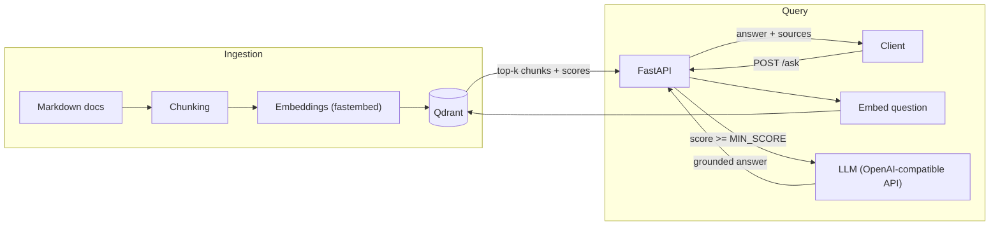
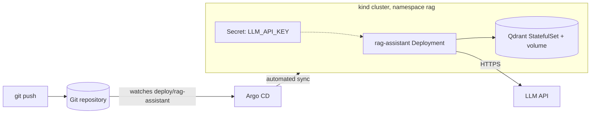

# RAG Assistant on Kubernetes

A small retrieval-augmented generation (RAG) service: ask a question in natural language, and it answers **only from your own documents**, citing the source files it used. When the documents don't contain the answer, it says so instead of guessing.

Built as a hands-on project to practice shipping an AI service the way it would go to production: configurable, tested, containerized, and deployed to Kubernetes with GitOps (Argo CD), with secrets kept out of Git and out of images.

> The platform it runs on (kind cluster, Argo CD, Prometheus and Grafana, provisioned with Terraform) lives in a separate project: `<link to your platform repository>`.
>
> **Status:** the application, tests, Docker image and Argo CD deployment are in place. Metrics and dashboards, CI and an evaluation set are in progress. See the [Roadmap](#roadmap).

## How it works



1. **Ingestion:** Markdown files are split into chunks, embedded, and stored in Qdrant.
2. **Retrieval:** the question is embedded and the most similar chunks are fetched (cosine similarity).
3. **Filtering:** chunks below a relevance threshold are dropped. If nothing is left, the service answers "I don't know" without calling the LLM.
4. **Generation:** the LLM receives the question plus the retrieved chunks and must answer using only that context, citing sources.

### Deployment



## Tech stack

| Area            | Choice                                                                                      |
| --------------- | ------------------------------------------------------------------------------------------- |
| API             | FastAPI, Uvicorn, Python 3.13                                                               |
| Embeddings      | [fastembed](https://github.com/qdrant/fastembed) (ONNX, CPU only, `BAAI/bge-small-en-v1.5`) |
| Vector database | Qdrant                                                                                      |
| LLM             | Any OpenAI-compatible endpoint (default: Gemini API free tier)                              |
| Tests           | pytest                                                                                      |
| Packaging       | Docker (non-root, embedding model baked into the image)                                     |
| Orchestration   | Kubernetes (kind), Kustomize manifests                                                      |
| Delivery        | Argo CD (GitOps, automated sync)                                                            |
| Platform        | Terraform (kind cluster, Argo CD), Prometheus, Grafana                                      |

## Project structure

```
.
├── app/
│   ├── src/ragapp/
│   │   ├── main.py        # FastAPI app: /health, /ask
│   │   ├── config.py      # settings, all from environment variables
│   │   ├── chunking.py    # paragraph-based text chunker
│   │   ├── store.py       # embeddings + Qdrant (index and search)
│   │   ├── ingest.py      # CLI: docs/*.md -> Qdrant
│   │   ├── prompting.py   # system prompt and context builder
│   │   └── llm.py         # OpenAI-compatible client, retries, fallback model
│   ├── tests/
│   ├── Dockerfile
│   ├── requirements.txt        # runtime dependencies
│   └── requirements-dev.txt    # + test dependencies
├── deploy/
│   ├── rag-assistant/                   # Kustomize: Qdrant StatefulSet, app Deployment, Services
│   └── rag-assistant-application.yaml   # Argo CD Application
├── docs/                  # documents to ingest
└── scripts/
    ├── up-rag.sh          # deploy the stack on an existing cluster
    └── down-rag.sh        # remove the stack, keep the cluster
```

## Quickstart (local)

**Prerequisites:** Python 3.11+ (developed on 3.13), Docker, and an API key for an OpenAI-compatible LLM provider. The default setup uses the free tier of the Gemini API (create a key in Google AI Studio). Free-tier limits, models and terms change, so check them first.

```bash
# 1. Start the vector database (pin the same version as deploy/rag-assistant/qdrant.yaml)
docker run -d --name qdrant -p 6333:6333 -v qdrant_data:/qdrant/storage qdrant/qdrant:vX.Y.Z

# 2. Create a virtual environment and install dependencies
cd app
python3 -m venv .venv && source .venv/bin/activate
pip install -r requirements-dev.txt

# 3. Configure (this file is git-ignored; never commit it)
cat > .env <<'ENVEOF'
LLM_API_KEY=your-api-key
LLM_MODEL=your-model-name
LLM_FALLBACK_MODEL=optional-second-model
ENVEOF
set -a; source .env; set +a

# 4. Ingest the documents in ../docs
PYTHONPATH=src python -m ragapp.ingest ../docs

# 5. Run the API
uvicorn ragapp.main:app --reload --app-dir src
```

Ask a question:

```bash
curl -X POST localhost:8000/ask \
  -H "Content-Type: application/json" \
  -d '{"question": "where was Mikaela Shiffrin born?"}'
```

```json
{
  "answer": "Mikaela Shiffrin was born in Vail, Colorado. [mikaela_shiffrin.md]",
  "sources": ["mikaela_shiffrin.md"]
}
```

Interactive API docs are available at `http://localhost:8000/docs`.

To add or change documents, edit the files in `docs/` and run the ingestion command again. It rebuilds the collection from scratch, and no restart is needed.

## API

| Method | Path      | Description                                                 |
| ------ | --------- | ----------------------------------------------------------- |
| `GET`  | `/health` | Liveness and readiness check, returns `{"status": "ok"}`    |
| `POST` | `/ask`    | Body: `{"question": "..."}`. Returns `answer` and `sources` |

If the LLM provider is unavailable, `/ask` returns `502` with a generic message and logs the underlying error.

## Configuration

Everything is configured through environment variables, so the same image can run anywhere without code changes.

| Variable             | Default                           | Description                                                           |
| -------------------- | --------------------------------- | --------------------------------------------------------------------- |
| `QDRANT_URL`         | `http://localhost:6333`           | Qdrant endpoint                                                       |
| `QDRANT_COLLECTION`  | `docs`                            | Collection name                                                       |
| `EMBED_MODEL`        | `BAAI/bge-small-en-v1.5`          | Embedding model (384 dimensions)                                      |
| `EMBED_CACHE_DIR`    | _(unset)_                         | Where the embedding model is cached (`/app/model_cache` in the image) |
| `TOP_K`              | `4`                               | Number of chunks retrieved per question                               |
| `MIN_SCORE`          | `0.0`                             | Minimum similarity score to keep a chunk                              |
| `LLM_BASE_URL`       | Gemini OpenAI-compatible endpoint | Any OpenAI-compatible base URL                                        |
| `LLM_API_KEY`        | _(required)_                      | Provider API key (a Kubernetes Secret in the cluster)                 |
| `LLM_MODEL`          | `gemini-flash-latest`             | Primary model                                                         |
| `LLM_FALLBACK_MODEL` | _(unset)_                         | Used when the primary fails with a transient error                    |
| `LLM_MAX_RETRIES`    | `4`                               | Automatic retries with backoff (429/5xx)                              |

## Docker

```bash
cd app
docker build -t rag-assistant:0.1.1 .
docker run --rm -p 8001:8000 --env-file .env \
  -e QDRANT_URL=http://host.docker.internal:6333 rag-assistant:0.1.1
```

- Runs as a **non-root** user.
- The embedding model is **downloaded at build time**, so containers start fast and need no internet access to load it.
- Secrets are **never baked into the image** (`.env` is excluded by `.dockerignore`); they are passed at runtime.

## Deploy to Kubernetes (GitOps)

**Prerequisite:** the platform is up, meaning a kind cluster with Argo CD, created by the Terraform project.

```bash
# Build the image, then edit the constants at the top of scripts/up-rag.sh (image tags, paths)
docker build -t rag-assistant:0.1.1 app/

# Loads the images into kind, creates the namespace and Secret, registers the Argo CD
# Application, waits for the pods and ingests the documents
./scripts/up-rag.sh
```

The same steps by hand:

```bash
kind load docker-image rag-assistant:0.1.1 qdrant/qdrant:vX.Y.Z --name <cluster>
kubectl create namespace rag
kubectl -n rag create secret generic llm-credentials --from-literal=LLM_API_KEY="$LLM_API_KEY"
kubectl apply -f deploy/rag-assistant-application.yaml

# Ingest into the in-cluster Qdrant
kubectl -n rag port-forward svc/qdrant 6335:6333 &
(cd app && QDRANT_URL=http://localhost:6335 PYTHONPATH=src python -m ragapp.ingest ../docs)

# Try the service
kubectl -n rag port-forward svc/rag-assistant 8002:8000
curl -X POST localhost:8002/ask -H "Content-Type: application/json" -d '{"question":"..."}'
```

What gets deployed, in the `rag` namespace:

- `qdrant`: a StatefulSet with a 1 Gi volume claim, so vectors survive pod restarts.
- `rag-assistant`: a Deployment with readiness and liveness probes and resource requests and limits.
- Argo CD watches `deploy/rag-assistant` and keeps the cluster in sync with Git (automated sync, prune and self-heal).

Images are loaded directly into kind and pinned to explicit tags with `imagePullPolicy: IfNotPresent`. Never use `latest` here, because Kubernetes would try to pull it from the internet.

## Operations

| Goal                                    | How                                                                                                              |
| --------------------------------------- | ---------------------------------------------------------------------------------------------------------------- |
| Remove only this app, keep the platform | `./scripts/down-rag.sh`                                                                                          |
| Pause everything and free RAM           | `docker stop` the kind node containers; resume with `docker start` and `kind export kubeconfig --name <cluster>` |
| Destroy the whole platform              | `terraform destroy` in the Terraform project                                                                     |
| Rebuild from scratch                    | `terraform apply`, then `./scripts/up-rag.sh`                                                                    |

Qdrant data is disposable, because it is always rebuilt from `docs/`. The LLM key is the only state that does not live in Git; it is re-created from your local `.env`.

## Testing

```bash
cd app && pytest
```

The tests mock the vector store and the LLM, so they run without Qdrant or an API key.

## Design decisions

- **Grounded answers.** The prompt restricts the model to the retrieved context, requires it to say when it doesn't know, and asks for source citations.
- **Prompt-injection awareness.** Retrieved text is treated as data: the system prompt tells the model to ignore any instructions found inside documents.
- **Relevance threshold.** Off-topic questions are answered without spending an LLM call.
- **Provider-agnostic LLM layer.** The OpenAI-compatible interface means switching providers is a configuration change. Transient errors (429/5xx) are retried, then routed to a fallback model; authentication errors fail fast instead of being masked.
- **Config via environment.** No settings in code, which fits Kubernetes ConfigMaps and Secrets.
- **Secrets out of Git and images.** The API key lives only in a Kubernetes Secret created out of band.
- **Pod hardening.** Non-root user, no privilege escalation, all capabilities dropped, default seccomp profile.

## Known limitations

- Chunking is paragraph-based and can split a heading from its content. Heading-aware chunking is planned and will be adopted only if the evaluation set shows an improvement.
- The ingestion rebuilds the whole collection (fine for a small corpus, not for a large one).
- `/ask` has no authentication or rate limiting, and keeps no conversation history.
- The default LLM runs on a free tier, which has rate limits and occasional capacity errors (503). Documents sent to a free tier may be used by the provider, so only use public documents.
- The embedding model loads on the first request, so that request is slower.
- The Secret is created manually; there is no secrets-management integration yet.

## Roadmap

- [x] FastAPI service with health check and tests
- [x] Document ingestion and vector retrieval (Qdrant + fastembed)
- [x] Grounded generation with retries and model fallback
- [x] Dockerfile (non-root, model baked in)
- [x] Deployment on a local Kubernetes cluster (kind) via Argo CD, with the API key in a Kubernetes Secret
- [ ] Prometheus metrics (`/metrics`) and a Grafana dashboard
- [ ] CI with GitHub Actions: lint, test, build, image scan
- [ ] Evaluation set (about 10 questions) and `MIN_SCORE` tuning
- [ ] Heading-aware chunking, incremental ingestion
- [ ] Sealed Secrets or SOPS instead of a manually created Secret
- [ ] Run ingestion as a Kubernetes Job

## Sample data

The sample documents in `docs/` are Markdown files about alpine ski racers.

<!-- TODO: state where the documents come from and their license/attribution -->

## License

<!-- TODO: choose a license (e.g. MIT) and add a LICENSE file -->
